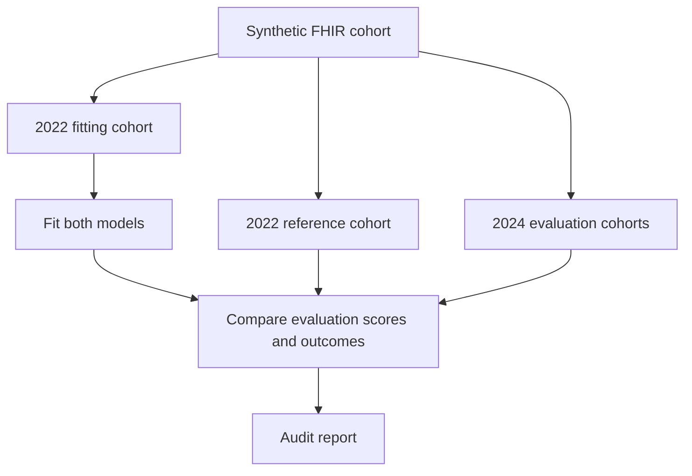

# Health AI Validation Toolkit

**A Research prototype for validating and monitoring chronic-disease risk models using synthetic FHIR R4 data.**

A model can assign patients roughly the same spread of risk scores after moving to a different clinic while underestimating how often the outcome actually occurs there. The availability of a feature can change at the same time. This toolkit audits all three signals together: which inputs are missing, how predicted probabilities are distributed, and how those probabilities compare with observed outcomes.

The first release studies a **first recorded type 2 diabetes diagnosis within 365 days** among adults with recorded prediabetes. It compares a logistic regression model using clinical features with a second model that also uses a simulated transportation-barrier field. Both models are evaluated on the same patients within each evaluation cohort.

## Table of contents

- [What the toolkit audits](#what-the-toolkit-audits)
- [Quick start](#quick-start)
- [Study design](#study-design)
- [Default results](#default-results)
- [Sample use cases](#sample-use-cases)
- [Project files](#project-files)
- [Limitations and future work](#limitations-and-future-work)

## What the toolkit audits

| Audit | Question | Output |
|---|---|---|
| **Input completeness** | Are features becoming less available than in the reference cohort? | Missing fraction, change from reference, and threshold flag |
| **Score distribution** | Has the distribution of predicted probabilities shifted? | Population Stability Index (PSI) and a score-distribution alert |
| **Calibration** | Do predicted probabilities agree with observed outcome rates? | Average predicted probability, observed event rate, signed gap, and calibration bins |
| **Feature comparison** | What changes when we add a simulated transportation-barrier field? | Side-by-side model metrics on identical evaluation patients |
| **Subgroup evaluation** | Do errors differ by age band or transportation documentation status? | Sample sizes, event counts, and metrics by group |
| **Prediction explanation** | How did the fitted model calculate one example score? | Intercept, feature contributions on the log-odds scale, and predicted probability |

This is the validation and responsible deployment project in the MedScope Analytics chronic-disease series. The **Cardiometabolic Risk Toolkit** establishes the synthetic FHIR cohort and risk-modeling workflow. The **Federated Chronic Care Benchmark** compares training arrangements. This toolkit focuses on what a validation reviewer would inspect before relying on a model in a different setting.

## Quick start

Use Python **3.11 or 3.12**. From the repository directory:

```bash
python -m venv .venv
source .venv/bin/activate
python -m pip install -r requirements.txt
python audit.py
python -m unittest discover -s tests -v
```

The audit writes `build/audit-report.json`. See the [user guide](USER-GUIDE.md) for Windows commands, report fields, and reproducibility instructions. The demo generates all inputs locally and requires no FHIR server or access to clinical records.

## Study design

### Cohort and outcome

The toolkit reuses the companion project's synthetic FHIR R4 `Patient`, `Condition`, and `Observation` data. Patients must have recorded prediabetes by the prediction date, no recorded type 2 diabetes by that date, and at least 365 days of simulated follow-up. The outcome is the first type 2 diabetes diagnosis recorded during the next 365 days. In a real study, its timing could depend on screening, access to care, and documentation as well as disease progression.

The clinical model uses age, the latest eligible A1c, and the change from the preceding eligible A1c. A lab result must have been measured and issued by the prediction date to qualify. The second model adds a synthetic transportation field with three observed states: a recorded barrier, a recorded absence of a barrier, and unknown status.

### Fitting, reference, and evaluation

| Population | Patients in default run | Role |
|---|---:|---|
| North and South, 2022 fitting cohort | 1,486 | Fit preprocessing and both models |
| North and South, 2022 reference cohort | 370 | Establish comparison distributions for feature missingness and model scores |
| North and South, 2024 | 847 | Evaluate both models on later patients at the same two clinics |
| Coastal, 2024 | 831 | Evaluate both models at a clinic excluded from fitting and reference |

The reference rows are held out from model fitting. The two 2024 cohorts are used to measure performance after the outcome window has elapsed. Coastal has a higher simulated probability of the outcome and more missing transportation documentation. Its evaluation combines changes in site and time.



## Default results

The bundled report uses seed `42`. Calibration gap is the average predicted probability minus the observed event rate. A negative value indicates underprediction on average.

| Evaluation cohort | Model | AUROC | Brier score | Calibration gap |
|---|---|---:|---:|---:|
| Later period | Clinical | 0.693 | 0.1211 | −0.65 percentage points |
| Later period | Clinical plus transportation | 0.685 | 0.1217 | −0.70 percentage points |
| Held-out clinic | Clinical | 0.682 | 0.1828 | −9.54 percentage points |
| Held-out clinic | Clinical plus transportation | 0.674 | 0.1836 | −9.64 percentage points |

Transportation documentation was missing for **11.1%** of the reference cohort and **34.4%** of the held-out clinic. The **23.3 percentage point** increase triggered the missingness alert. Both models triggered the held-out clinic calibration alert, while their predicted-score distributions stayed below the demo's PSI alert threshold.

The added transportation field did not improve the reported overall AUROC or Brier score in this run. The simulator gives that field no direct role in generating the outcome, so these results describe the configured experiment. They do not establish the value of transportation documentation for clinical prediction.

See the [sample audit report](docs/sample-audit-report.json) for the full results.

## Sample use cases

### 1. Identify a change in transportation documentation

**Scenario.** A data quality lead wants to determine whether the field is being captured consistently after moving to another clinic.

Open `evaluation.held_out_site.feature_checks.transport_barrier`. Compare `missing_rate` with `reference_missingness.transport_barrier`. Review `change_from_reference` and the alert flag. Then look at the `transport_unknown` subgroup to see how many evaluation patients have unavailable documentation.

**What to take away.** A rise in missing records is a change in documentation availability. The report keeps unknown status distinct from a documented absence of a barrier.

### 2. Test whether the transportation feature improves prediction

**Scenario.** A model reviewer wants to know whether including the field changes performance on the same patients.

Within each evaluation window, compare `models.clinical.overall` and `models.with_transport.overall`. Confirm that the patient and event counts match. Compare AUROC for ranking, Brier score for probability error, and signed calibration gaps for average underprediction or overprediction.

**What to take away.** The paired comparison holds the evaluation population fixed. It describes performance under the simulation rules and provides no evidence of a causal effect from transportation access.

### 3. Investigate underprediction when score drift is low

**Scenario.** A monitoring analyst sees a calibration alert at Coastal but no score-distribution alert.

Compare `score_psi` with the demo threshold. Then inspect `overall.mean_score`, `overall.observed_rate`, and `overall.calibration_gap`. Open the populated calibration bins and compare their patient counts, mean scores, and observed rates.

**What to take away.** Distribution checks can run on scores alone. Calibration checks need observed outcomes and can detect a problem even when predicted scores remain similarly distributed.

### 4. Review performance for a subgroup

**Scenario.** A reviewer wants to understand whether the overall result obscures errors among patients aged 65 or older or among patients with unknown transportation status.

Open `subgroups` under the same model and evaluation window. Start with `n` and `events`, then compare calibration gaps and Brier scores. Read age and transportation as separate breakdowns. A patient can appear in one age group and one transportation group.

**What to take away.** Subgroup summaries can help prioritize further investigation. Small groups and few events limit the conclusions that can be drawn from point estimates.

### 5. Reconstruct an individual prediction

**Scenario.** A collaborator wants to see how the fitted model calculated an example score for a synthetic patient.

Open `example_explanation` for either model. Add the intercept to the displayed log-odds contributions. Apply the logistic transformation to recover the reported probability. In the transportation model, inspect which terms represent imputed inputs or missingness indicators.

**What to take away.** The breakdown explains the computation for one patient. Its feature contributions are on the log-odds scale and do not represent changes in probability or causal effects.

## Project files

| File | Purpose |
|---|---|
| [User guide](USER-GUIDE.md) | Installation, commands, report definitions, alert thresholds, and reproduction |
| [Audit script](audit.py) | Model fitting, missingness and score checks, evaluation, and explanations |
| [Study fixture](study_fixture.py) | Synthetic FHIR generation and cohort extraction |
| [Methods](docs/methods.md) | Reference cohort design, calculation rules, and simulation assumptions |
| [Sample audit report](docs/sample-audit-report.json) | Complete output from the default run |
| [Tests](tests/test_audit.py) | Checks score drift, documentation states, paired evaluation, and explanation math |

## Limitations and future work

The current release runs a batch audit on two fixed evaluation cohorts. The missingness, PSI, and calibration thresholds are illustrative settings. A deployed workflow would need defined monitoring windows, handling for delayed outcome labels, and a review process for alerts.

The transportation field is an illustrative social determinants of health feature. Broader work could evaluate additional access-to-care measures, examine documentation practices across sites, and add uncertainty intervals for subgroup metrics. Real-world external validation requires appropriately authorized independent data and a prespecified protocol.

**Intended use:** Research and education. All records and reported model results are synthetic. The toolkit has no established clinical validity and is unsuitable for patient care or clinical decision-making.
